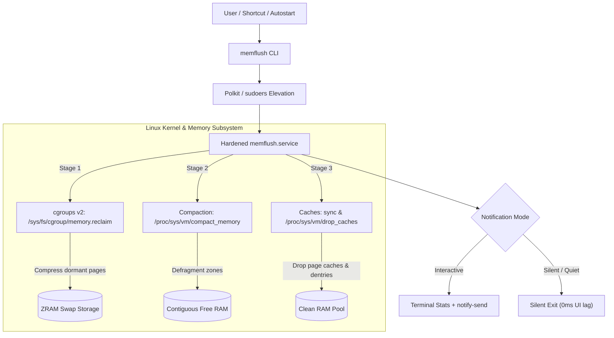

<div align="center">

# ⚡ memflush

**Advanced Linux Memory Compaction & Cache Flush Utility**

*Proactively reclaim cold process memory into ZRAM, defragment RAM zones, and flush kernel caches with zero daemon overhead.*

[](LICENSE)
[](https://github.com/NyrfHello/memflush/actions)
[](https://github.com/NyrfHello/memflush/releases)
[](#-installation)
[](contrib/arch/PKGBUILD)

[Features](#-features) • [How It Works](#-how-it-works) • [Installation](#-installation) • [CLI Usage](#-cli-usage) • [Keybindings](#-desktop-keybindings) • [Boot Trim](#-the-8-second-boot-trim) • [Contributing](#-contributing--governance)

---

</div>

## 🚀 Features

- **Proactive ZRAM Memory Offloading:** Unlike legacy scripts that only drop file caches, `memflush` uses Linux cgroups v2 (`memory.reclaim`) to proactively compress cold, dormant application pages into **ZRAM** swap.
- **Kernel Zone Compaction:** Triggers proactive memory defragmentation (`compact_memory`) to satisfy high-order allocation requests, reducing system stutter during gaming and multitasking.
- **Safe Cache Reclamation:** Safely syncs dirty buffers and flushes page caches, directory entries (dentries), and inodes without killing running applications or risking data loss.
- **Zero Daemon Footprint:** Runs on demand in milliseconds via a hardened `systemd` unit. Consumes **0 MB RAM** while idle.
- **Dual Presentation:** Clean, colored terminal statistics with human-readable units (MB / GB) and seamless desktop notifications via `notify-send`.
- **Passwordless Hotkey Execution:** Ships with Polkit and sudoers configuration allowing non-root desktop shortcut activation without password dialog interruptions.
- **Full Shell Completion & Man Page:** Includes native completions for **Bash**, **Zsh**, and **Fish**, plus a complete `man memflush` manual.

---

## 🧠 How It Works

Traditional tools only write to `/proc/sys/vm/drop_caches`, which only reclaims inactive file buffers. `memflush` operates across a 3-stage lifecycle to optimize both process heap and filesystem memory:



---

## 📊 Before & After Preview

Here is an example run on a desktop under active multitasking:

```text
$ free -h
               total        used        free      shared  buff/cache   available
Mem:           7.4Gi       4.8Gi       520Mi       210Mi       2.1Gi       2.4Gi
Swap (zram0):  7.4Gi       412Mi       7.0Gi

$ memflush
[memflush] Measuring system memory...
           Cached: 2180 MB / Total RAM: 7628 MB
[memflush] Trimming cold memory, compacting zones, and dropping caches...
[memflush] Success! Reclaimed: 1.4 GB | Available: 5.8 GB (Total: 7628 MB)

$ free -h
               total        used        free      shared  buff/cache   available
Mem:           7.4Gi       1.6Gi       5.3Gi       180Mi       512Mi       5.8Gi
Swap (zram0):  7.4Gi       840Mi       6.6Gi
```

---

## 📦 Installation Matrix

Choose the installation method suited to your distribution:

### 1. Arch Linux / CachyOS (makepkg / AUR)

Build and install cleanly using `makepkg` so `pacman` tracks all files:

```bash
git clone https://github.com/NyrfHello/memflush.git
cd memflush/contrib/arch
makepkg -si
```

*(Or via your AUR helper once published: `paru -S memflush` / `yay -S memflush`)*

---

### 2. Universal Linux (Makefile)

Standard Linux installation adhering to `PREFIX` and `DESTDIR`:

```bash
git clone https://github.com/NyrfHello/memflush.git
cd memflush
sudo make install
```

---

### 3. Standalone Installer Script

If you prefer not using `make`, use the standalone script:

```bash
git clone https://github.com/NyrfHello/memflush.git
cd memflush
chmod +x install.sh
sudo ./install.sh
```

---

## 💻 CLI Usage

Open any terminal and run:

```bash
memflush
```

### Command-Line Flags

| Flag | Long Flag | Description |
| :--- | :--- | :--- |
| `-n` | `--no-notify` | CLI terminal output only (skips desktop notification). Ideal for SSH or scripts. |
| `-s` | `--silent` | Completely silent (no terminal text, no notification). Ideal for desktop hotkeys. |
| `-q` | `--quiet` | Alias for `--silent` (ideal for autostart scripts & cron). |
| `-v` | `--version` | Display version information (`memflush v1.1.0`). |
| `-h` | `--help` | Show command usage and options manual. |

View the system manual page anytime:
```bash
man memflush
```

---

## ⌨️ Desktop Keybindings

Bind `memflush` to a key combination (e.g. `Super + Shift + Backspace`) for on-demand memory clearing during gaming or heavy workloads:

### Hyprland

- **Standard (`~/.config/hypr/hyprland.conf`):**
  ```ini
  bind = SUPER SHIFT, Backspace, exec, memflush
  ```

- **CachyOS Lua (`~/.config/hypr/config/binds.lua`):**
  ```lua
  hl.bind(mainMod .. " + SHIFT + Backspace", hl.dsp.exec_cmd("memflush"))
  ```

### Sway / i3

Add to `~/.config/sway/config` or `~/.config/i3/config`:
```ini
bindsym $mod+Shift+BackSpace exec memflush
```

### KDE Plasma

1. Open **System Settings** $\rightarrow$ **Shortcuts** $\rightarrow$ **Custom Shortcuts**.
2. Click **Add New** $\rightarrow$ **Global Shortcut** $\rightarrow$ **Command/URL**.
3. Name: `Flush Memory`.
4. Trigger: Set your shortcut (e.g., `Super + Shift + Backspace`).
5. Action: Enter `memflush`.
6. Click **Apply**.

### GNOME

1. Open **Settings** $\rightarrow$ **Keyboard** $\rightarrow$ **View and Customize Shortcuts** $\rightarrow$ **Custom Shortcuts**.
2. Click the **+** (Add Shortcut) button.
3. **Name:** `Flush Memory`
4. **Command:** `memflush`
5. **Shortcut:** Press `Super + Shift + Backspace`.

---

## ⚡ The 8-Second Boot Trim

After booting, Linux retains hundreds of initialization files, icons, and fonts in active memory. You can automatically reclaim this RAM after reaching the desktop:

### In Hyprland Autostart
```ini
exec-once = sh -c 'sleep 8 && memflush --silent'
```
*(Or in CachyOS `autostart.lua`: `hl.exec_cmd("sh -c 'sleep 8 && memflush --silent >/dev/null 2>&1'")`)*

### In Sway
```ini
exec sh -c 'sleep 8 && memflush --silent'
```

### In XDG Desktop Autostart (GNOME / KDE / XFCE)
Create `~/.config/autostart/memflush-boot.desktop`:
```ini
[Desktop Entry]
Type=Application
Name=Memflush Boot Trim
Exec=sh -c "sleep 8 && memflush --silent"
Hidden=false
NoDisplay=true
X-GNOME-Autostart-enabled=true
```

---

## 🛡️ Security & Systemd Sandboxing

`memflush.service` runs with systemd sandboxing directives enabled:

- `ProtectHome=true`: Prevents access to `/home`, `/root`, and user documents.
- `PrivateTmp=true`: Enforces isolated temporary directories.
- `RestrictAddressFamilies=AF_UNIX`: Disallows network and internet access.
- `NoNewPrivileges=false`: Retains minimal privileges necessary for cgroup memory writes.

For details on security boundaries and private vulnerability reporting, see [SECURITY.md](SECURITY.md).

---

## 🗑️ Uninstallation

To cleanly remove `memflush`, service units, documentation, and permission rules:

```bash
# Via Makefile:
sudo make uninstall

# Or via script:
sudo ./uninstall.sh
```

---

## 🤝 Contributing & Governance

Contributions, bug reports, and optimizations are welcome!
- Review [CONTRIBUTING.md](CONTRIBUTING.md) for testing guidelines and Conventional Commits standards.
- Review [CODE_OF_CONDUCT.md](CODE_OF_CONDUCT.md) for our community code of conduct.
- Check [CHANGELOG.md](CHANGELOG.md) for version release notes.

---

## 📄 License

This project is licensed under the [MIT License](LICENSE) — see the [LICENSE](LICENSE) file for details.
